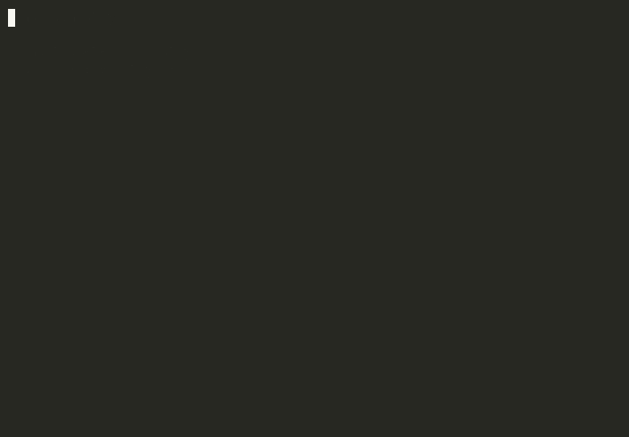

# Angular Dojo VlV

**Cada rama es una app de Angular ya rota. Tu trabajo es repararla — y `npm run verify` te dice si lo lograste.**

[](https://angular.dev)
[](https://angular.dev/guide/zoneless)
[](https://www.typescriptlang.org)
[](https://jestjs.io)
[](https://playwright.dev)
[](https://github.com/VlV-515/Angular-Dojo-VlV/actions/workflows/ci.yml)
[](LICENSE)

No hay backend, no hay envíos, no hay ranking en la nube. Clonas el repo, eliges un reto,
lees el brief, arreglas el código en tu editor y corres un comando. Así de simple, y así de
honesto: si `npm run verify` queda en verde, lo resolviste. Si no, todavía no.



## Jugar en el navegador

¿No quieres instalar nada? Entra a **[vlv-515.github.io/Angular-Dojo-VlV](https://vlv-515.github.io/Angular-Dojo-VlV/)**,
elige un reto y dale a **Abrir en Codespaces**: se abre VS Code en el navegador, ya en la rama del
reto, con dependencias y Chromium instalados. `npm run verify` funciona exactamente igual que en
local (Jest, Playwright y `ng build` incluidos).

[](https://codespaces.new/VlV-515/Angular-Dojo-VlV?ref=challenge%2Fjunior%2Frouting&quickstart=1)

Necesitas cuenta de GitHub; Codespaces incluye 60 horas al mes gratis. Detén el codespace al
terminar para no gastar horas de más.

## Cómo funciona

**1. Clona y elige un reto**

```bash
git clone https://github.com/VlV-515/Angular-Dojo-VlV.git
cd Angular-Dojo-VlV
npm install
npm run play
```

`npm run play` abre un menú: cinturón, tema, síntoma, tiempo estimado y tu estado. Al elegir uno
hace `git switch` a esa rama y te imprime el brief (`CHALLENGE.md`) directo en la terminal.

**2. Arregla el código**

Cada rama es una app de Angular real y completa — no un fragmento aislado. Algo está roto: no
compila, la pantalla queda en blanco, la UI se congela, la app se pone lenta con muchos datos...
Tú decides cómo arreglarlo. No hay un único camino correcto, solo un resultado verificable.

```bash
npm start   # para verla correr mientras trabajas
```

**3. Verifica**

```bash
npm run verify
```

Corre lo que ese reto necesite — Jest, Playwright, `ng build`, o una combinación — y te dice
exactamente qué falta. ¿Atorado? `npm run hint` te da una pista a la vez, nunca las tres de
un jalón. ¿Quieres empezar de nuevo? `npm run reset`.

## Catálogo de retos

| Rama | Cinturón | Tema | Síntoma | Verifica | Tiempo | Estado |
|---|---|---|---|---|---|---|
| `challenge/junior/routing` | blanco | Router | "pantalla en blanco" | Jest + Playwright | 30 min | **disponible** |
| `challenge/junior/no-compila` | blanco | TS + plantillas | "no compila" | `ng build` + Jest | 25 min | **disponible** |
| `challenge/junior/bindings-control-flow` | blanco | Bindings y control flow | "algunos cambios no se reflejan en pantalla" | Jest | 30 min | **disponible** |
| `challenge/junior/forms-basico` | blanco | Formularios reactivos | "el formulario nunca valida" | Jest | 35 min | **disponible** |
| `challenge/junior/signals-basico` | blanco | Signals | "el contador no cambia" | Jest | 30 min | **disponible** |
| `challenge/junior/http-resource` | blanco | HTTP con `resource`/`httpResource` | "la ficha no cambia" | Jest + Playwright | 35 min | **disponible** |
| `challenge/mid/zoneless-no-refresca` | azul | Change detection | "la UI se congela" | Jest + Playwright | 60 min | **disponible** |
| `challenge/mid/race-condition` | azul | RxJS | "resultados fuera de orden" | Jest (fake timers) + Playwright | 70 min | **disponible** |
| `challenge/mid/di-ng0203` | azul | Dependency Injection | "la app truena con NG0203" | Jest (fake timers) | 55 min | **disponible** |
| `challenge/mid/guards-interceptors` | azul | Guards e interceptors | "cualquiera entra al panel" | Jest + Playwright | 60 min | **disponible** |
| `challenge/senior/perf-lista` | negro | Performance | "se arrastra con 10k filas" | Playwright + budget de build | 120 min | **disponible** |
| `challenge/senior/memory-leak` | negro | Ciclo de vida | "la memoria crece al navegar" | Jest + Playwright | 120 min | **disponible** |
| `challenge/senior/ssr-hydration` | negro | SSR e hidratación | "NG0500/NG0501 y doble fetch al hidratar" | Playwright + `ng build` (SSR) | 100 min | **disponible** |
| `challenge/senior/a11y-focus-trap` | negro | Accesibilidad: focus trap | "el foco se escapa del diálogo" | Playwright + axe-core | 90 min | **disponible** |

Por cada `challenge/<nivel>/<tema>` existe su contraparte `solution/<nivel>/<tema>` — el mismo
reto, ya resuelto, publicada para que compares tu enfoque después de intentarlo (no antes).

> El catálogo completo, con metadatos, vive en [`challenges.json`](challenges.json) y se genera
> con `npm run catalog` a partir de `challenges/*/meta.json`.

### Las ramas se regeneran

`main` es la única fuente de verdad; las ramas `challenge/*` y `solution/*` son un artefacto
**generado** por `npm run build:branches` a partir del tag `base-v1`. Cuando se agregan retos o se
ajusta el shell, esas ramas se vuelven a materializar y se publican de nuevo con
`git push --force-with-lease`, que reescribe su historia (un solo commit por rama, siempre).

Si ya tenías el repo clonado, antes de volver a intentar un reto corre:

```bash
git fetch --all --prune
```

Así traes las ramas actualizadas y limpias las que ya no existen en el remoto. No hagas
`git pull` dentro de una rama `challenge/*` con cambios locales sin commitear — mejor
`npm run reset` o vuelve a hacer `npm run play` desde `main`.

## Reglas del dojo

1. **No mires `solution/*` antes de intentarlo.** Si te rendiste, está bien mirarla — pero
   después de pelear un rato, no antes.
2. **No edites nada dentro de `verify/`.** Es la parte que califica el reto, no el reto en sí.
   `npm run verify` compara el hash de esos archivos contra el original y te avisa si no coinciden.
3. **Un reto a la vez.** Termina o resetea (`npm run reset`) antes de saltar a otro; el CLI te
   avisa si tienes cambios sin commitear.
4. **Las pistas se piden, no se buscan en el código fuente.** `npm run hint` existe para eso.
5. **El objetivo es entender el porqué, no solo poner `verify` en verde.** Usa las herramientas
   que quieras para investigar — pero si solo copias sin entender, el próximo reto te va a costar
   el doble.

## Cinturones

|  |  |  |  |
|:---:|:---:|:---:|:---:|
| **Blanco**<br>Punto de partida | **Azul**<br>Terminar los 6 retos de blanco | **Negro**<br>Terminar los 4 retos de azul | **Maestro**<br>Terminar los 4 retos de negro |

En el [sitio del dojo](https://vlv-515.github.io/Angular-Dojo-VlV/) el logo y el favicon toman el color
de tu cinturón actual según los retos que marques como resueltos.

## Rúbrica: qué significa pasar cada cinturón

| Cinturón | Retos que lo componen | Lo que demuestra |
|---|---|---|
| **Blanco (junior)** | routing, no-compila, bindings-control-flow, forms-basico, signals-basico, http-resource | Lees un error de TypeScript con `strictTemplates` y sabes qué te está diciendo. Entiendes bindings, `@if`/`@for`, formularios reactivos, signals básicas y cómo `resource`/`httpResource` cargan datos. |
| **Azul (mid)** | zoneless-no-refresca, race-condition, di-ng0203, guards-interceptors | Sabes por qué una mutación no dispara change detection en una app zoneless, qué operador de RxJS usar cuando el orden de las respuestas importa, por qué `inject()` truena con NG0203 fuera de contexto, y cómo proteger una ruta y una petición de verdad. |
| **Negro (senior)** | perf-lista, memory-leak, ssr-hydration, a11y-focus-trap | Puedes perfilar por qué una lista de 10 000 filas se arrastra, encontrar una suscripción que nadie liberó, diagnosticar un error de hidratación en SSR (NG0500/NG0501) y garantizar que un diálogo sea usable con teclado y lector de pantalla. |

`npm run progress` pinta tu avance por cinturón en cualquier momento.

## Para entrevistadores

Un reto de este repo funciona bien como ejercicio de live coding porque **no lo escribiste tú**:
es código ajeno, con un bug real y una verificación objetiva, no una opinión sobre el estilo de
quien lo resuelve.

Sugerencia de uso:

1. Elige un reto acorde al nivel de la vacante (la tabla de arriba trae cinturón y tiempo estimado).
2. Comparte solo la rama `challenge/<nivel>/<tema>` — la de `solution/*` es pública, así que si te
   importa que no la vean antes, dales un checkout específico en vez del repo completo.
3. Dales el tiempo estimado de `meta.json` más un margen razonable. `npm run verify` es el
   criterio objetivo; cómo llegaron ahí es lo que evalúas tú.
4. `npm run hint` está disponible para la persona candidata igual que en cualquier trabajo real:
   usarlo no es trampa, ignorarlo tampoco es un plus.

## Cómo contribuir

¿Quieres agregar un reto nuevo? Lee [`CONTRIBUTING.md`](CONTRIBUTING.md) — el resumen corto es:
copia `challenges/_template/`, siembra los bugs en `overlay/`, arréglalos en `solution/`, escribe
`verify/` para que falle en uno y pase en el otro, y corre `npm run ci:check-challenges` antes de
abrir el PR.

## Roadmap

**Tanda 1 y Tanda 2** — completas, ver tabla de arriba (14 retos).

**Tanda 3 — próximamente**

- mid: forms avanzado con `ControlValueAccessor` · tests rojos
- senior: API pública de librería (`input()`/`output()`/`model()`) · `NG0100`/`NG0200` · `@defer`/chunks/budgets
- Expansión según lo que pida la comunidad. Abre un issue si tienes un bug real de Angular que
  te haya dolido y creas que merece ser un reto.

## FAQ

**¿Tengo que enviar mi solución a algún lado?**
No. No hay servidor, no hay cuenta, no hay ranking. `npm run verify` corre en tu máquina y el
resultado es tuyo.

**¿Puedo usar un asistente de IA para resolver los retos?**
Es tu tiempo. El punto de estos retos no es que `verify` quede en verde — es que la próxima vez
que veas ese mismo bug en un código real, lo reconozcas en segundos. Usa las herramientas que
quieras, pero no te hagas trampa a ti mismo.

**Edité algo en `verify/` sin querer, ¿ahora qué?**
`npm run reset` restaura el reto completo a su estado original (con confirmación antes de
descartar tus cambios).

**¿Por qué Jest y no Karma/Jasmine?**
Karma quedó deprecado a partir de Angular v20. Jest con `jest-preset-angular` corre en Node,
arranca más rápido y tiene mejor soporte para fake timers, útil para los retos de condiciones de
carrera.

**¿Por qué las ramas no se editan a mano?**
Con 14 retos y una sola plataforma base, un cambio en el shell (una versión de Angular, un ajuste
de estilos) tendría que replicarse a mano en cada rama. En vez de eso, `main` es la única fuente
de verdad y `scripts/build-branches.mjs` regenera las ramas desde ahí (ver "Las ramas se
regeneran" más arriba).

## Stack técnico

- **Angular 20** — standalone components, signals, `provideZonelessChangeDetection()`, nuevo
  control flow (`@if`/`@for`), `resource()`/`httpResource()`.
- **`@angular/ssr`** vive en el `package.json` base como dependencia, pero solo se activa desde el
  `overlay/` del reto `senior/ssr-hydration` — el resto de los retos y el shell corren 100% en el
  navegador.
- **TypeScript strict** — `strict`, `strictTemplates`, `noPropertyAccessFromIndexSignature`.
- **Jest** + `jest-preset-angular` (`setupZonelessTestEnv()`) para unit e integración con TestBed.
- **Playwright** + `@axe-core/playwright` para e2e y accesibilidad contra Chromium real.
- **Cero dependencias en el CLI del dojo** — `scripts/*.mjs` usa solo `node:*` (incluido
  `readline/promises` para los menús interactivos).
- Mock API en memoria con semilla fija (`src/app/core/mock-api/`) para fixtures y errores
  deterministas, sin red real.

## Licencia

[MIT](LICENSE) — usa esto para practicar, para entrevistar, para enseñar. Si armas tu propio
dojo a partir de este repo, un crédito se agradece pero no se exige.
